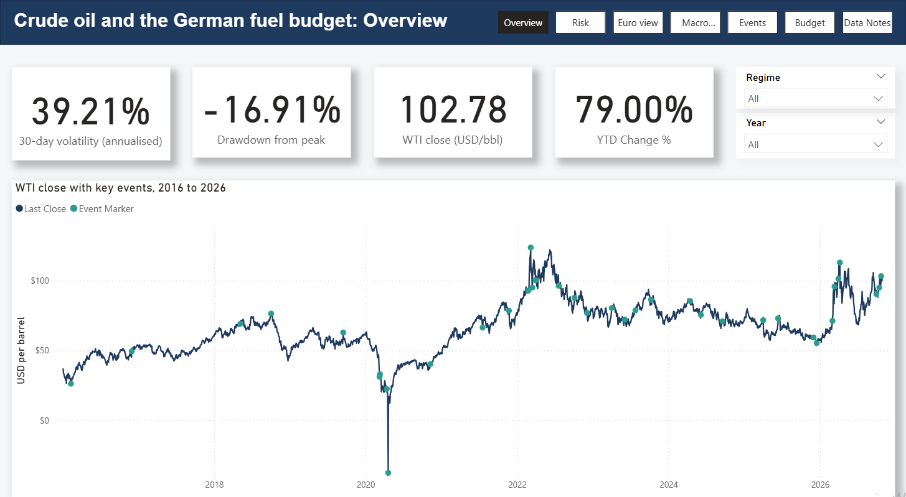
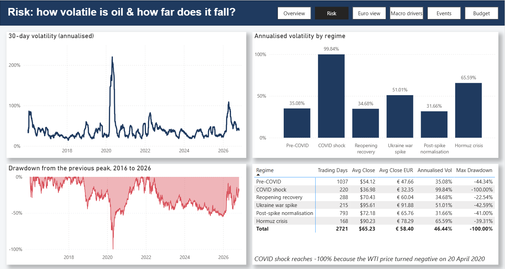
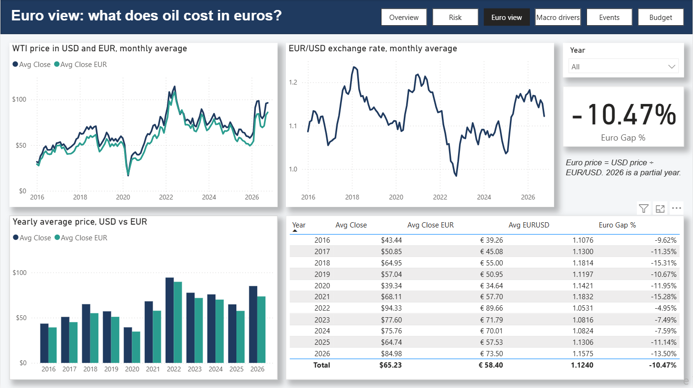
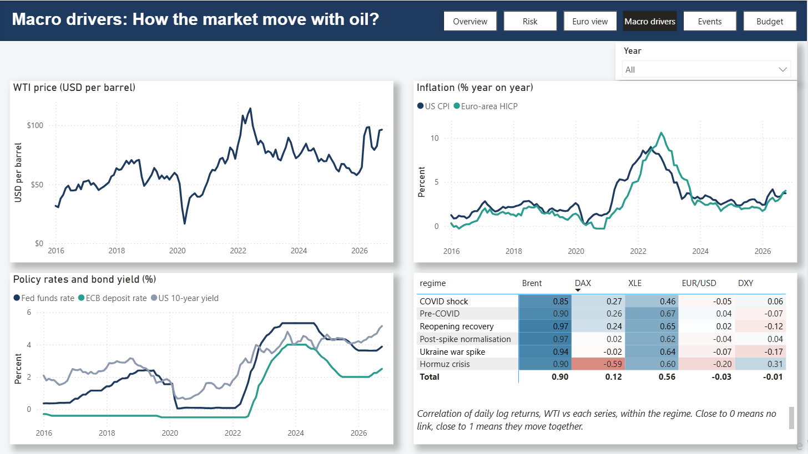
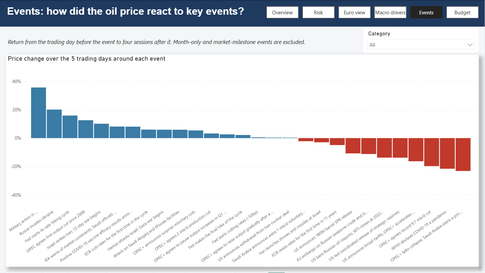
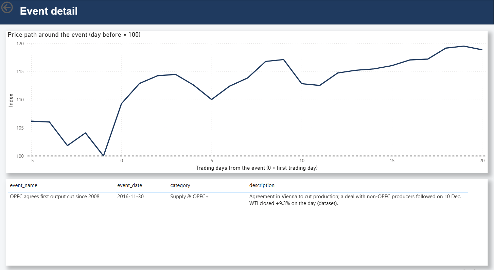
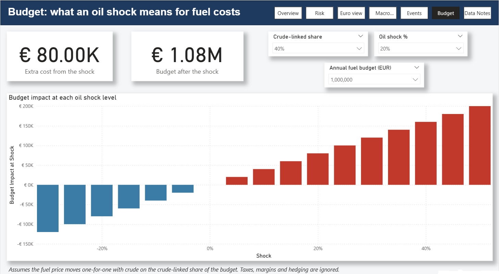

# Crude Oil and the German Fuel Budget 2016–2026

Volatility, euro cost and event reactions: a business analysis in Power BI

---

## 1. Introduction

A German company with fuel costs buys in euros, but the oil market prices in US dollars. This project follows ten years of daily WTI crude oil prices (January 2016 to 28 October 2026) together with exchange rates, interest rates, inflation, equity indices, and a table of 40 dated events, and asks what that history means for a fuel budget.

The analysis is **descriptive**. It shows what happened and how markets moved together. It does not forecast prices or give investment advice.

The work has two parts:

- **Python (Jupyter notebook)** downloads and cleans the data and writes four tables for Power BI.
- **Power BI report** with six pages, one for each business question, plus an overview page and a drill-through page for single events.



*Overview page: the latest close, the change since the end of 2025, the drawdown from the ten-year high and the price history with the 40 events marked.*

---

## 2. Business questions

| # | Business question | Who cares | Decision it supports |
|---|---|---|---|
| Q1 | How did volatility change across market periods? | Controlling, procurement | How large a planning range and contingency to use |
| Q2 | How deep were the falls, and how long did recovery take? | Finance, risk management | Whether a past peak is a safe budget anchor |
| Q3 | What did a barrel cost in euros compared with dollars? | Procurement, treasury | Whether to budget in euros and watch EUR/USD |
| Q4 | How do rates, the dollar, inflation and other markets relate to oil? | Analysts, risk management | Which indicators are worth monitoring |
| Q5 | How did the price react to major events? | Procurement, risk management | How to classify news in a risk log |
| Q6 | What would a change in oil mean for a fuel budget? | Management, controlling | How large a contingency to hold and how much cost to link to crude |

---

## 3. Data and preparation

### 3.1 Data sources

| Data | Source | Used for |
|---|---|---|
| WTI crude oil, daily (`CL=F`) | Yahoo Finance | The core series |
| Brent crude, EUR/USD, US dollar index, DAX, XLE | Yahoo Finance | Questions 3 and 4 |
| Fed funds rate, 10-year US yield, US CPI | FRED | Question 4 |
| ECB deposit rate, euro-area inflation (HICP) | ECB Data Portal | Questions 3 and 4 |
| 40 dated events with source link and verification status | Public sources (EIA, news reports), listed in `data/events_template.csv` | Question 5 |

The market data are downloaded by the notebook and are **not stored as CSV files in this repository**, because Yahoo Finance data is for personal use. The Power BI file contains the loaded data for viewing only. *To rebuild the data, run the notebook (section 7).*

### 3.2 What the notebook does

1. Downloads WTI and the other markets and cuts every series at the end date (28 October 2026, included).
2. Guards the log returns against the negative price of 20 April 2020.
3. Forward-fills holiday gaps of the other markets by at most three days.
4. Anchors every event to the first trading day on or after its date and numbers the trading days (`trading_day_seq`).
5. Writes four tables to `powerbi_data/`: `fact_daily`, `dim_date`, `dim_regime`, `dim_event`.

### 3.3 Data pitfalls handled

- WTI closed at **-37.63 USD on 20 April 2020**. Percentage returns are undefined there, so returns are blank on that day and the COVID drawdown is capped at -100%.
- The WTI series is a continuous futures contract, so prices can jump when the contract rolls. It is not a pump price.
- Monthly inflation is dated to the first of the month, so a value is not known on that date.
- The ECB inflation series changed at the end of 2025. The two series are spliced, and the splice was checked against Eurostat.

### 3.4 Power BI model

A star schema: `fact_daily` (one row per oil trading day, 2,721 rows) with `dim_date`, `dim_regime` (six market periods), `dim_event` (40 events) and a helper `Offset` table. Relationships are one to many, single direction. The DAX measures cover annualised and 30-day volatility, drawdown, euro price via EUR/USD, event window return, event path index, correlation written out with `SUMX`, and what-if parameters for the budget page.

Full column and measure definitions: [Data dictionary](docs/data_dictionary.md). Reasoning behind the choices: [Methodology](docs/methodology.md).

---

## 4. Results

### 4.1 Volatility and falls (Q1 and Q2)



- Three periods are calm, at **32% to 35%** annualised volatility. The Ukraine war spike reached **51%**, the 2026 Hormuz crisis **66%** and the COVID shock about **100%**.
- As a rough rule, a typical monthly move is annualised volatility divided by 3.5: about 10% in calm periods and about 19% in the Hormuz crisis.
- In four of the six periods the worst fall from a peak was **39% to 44%**. The COVID figure of -100% is an artefact of the negative price.
- Recovery took very different lengths: 13 months after the pre-COVID high, three years after the 2018 peak. The March 2022 high of \$123.70 has **not been regained after 4.6 years**.

**To keep in mind.** Volatility counts rises and falls alike, but a fuel buyer is hurt only by rises. The six periods were set around known events, and the Hormuz result rests on 168 trading days.

### 4.2 Euro view (Q3)



- On average a barrel cost **10.5% less in euros** than in dollars (€58.40 against \$65.23), almost entirely because EUR/USD stayed above 1.
- The cushion was thinnest in 2022 (5%). The euro weakened just as oil spiked, so the average euro price rose 55% over 2021, against 38% in dollars.
- In 2026 so far a stronger euro absorbed about 3.5 points of the dollar rise.

**To keep in mind.** Yearly averages hide timing, and a company that hedges the exchange rate does not feel the swing. The 2026 figures cover ten months only.

### 4.3 Macro drivers (Q4)



- Brent follows WTI closely (correlation 0.85 to 0.97 in every period). Energy shares follow oil clearly but only partly (0.46 to 0.67).
- The DAX is the series that changes: slightly positive in the first three periods (0.24 to 0.27) and **-0.59 during the Hormuz crisis**.
- The dollar index and EUR/USD show weak links that change sign between periods.
- Inflation followed the 2022 oil peak with a delay of a few months, and is rising again in 2026.

**To keep in mind.** The matrix uses same-day correlations of daily returns, so effects that take months are invisible to it. Correlation is not causation.

### 4.4 Events (Q5)





- Real supply disruptions pushed prices up over five trading days: Hormuz **+35.6%**, Russia's invasion of Ukraine **+20.1%**.
- Demand shocks and price wars pushed them down: the OPEC+ collapse **-23.1%** and the WHO pandemic declaration **-21.6%**.
- A record OPEC+ output cut was still followed by **-19.7%**, so the headline did not decide the direction.

**To keep in mind.** An event window return is not the effect of the event: windows overlap in crisis weeks, and the 40 events were chosen after the price history was known.

### 4.5 Budget (Q6)



- With a €1,000,000 budget of which 40% follows crude, every 10 points of oil price change is worth **€40,000** and a 20% rise costs **€80,000**.
- Applied to real moves from the earlier pages: a typical calm month about €40,000, a typical Hormuz month about €76,000, and the 2022 euro average against 2021 about €221,600.
- The crude-linked share is the lever the company controls, and it scales every outcome.

**To keep in mind.** The 40% share is an assumption. The model ignores taxes, margins, hedging and delivery lags.

The full page-by-page write-up is in [Results by report page](docs/results_by_report_page.md).

---

## 5. Practical conclusions

1. **Plan with ranges, not one number.** Use a calm range of about 10% per month, a stress range of about 19%, and expect falls of 40% or more from a peak that can last years.
2. **Budget in euros and watch EUR/USD.** The exchange rate cut the euro price by 5% to 15% in every year, but in 2022 it made the euro rise 17 points larger than the dollar rise.
3. **Decide how much of the cost follows crude.** Lowering this share, for example with fixed-price clauses, is as effective as predicting the price.

---

## 6. Limits

- The data are futures prices, not pump prices. The link between the two, including taxes and margins, is not measured.
- The report is descriptive. Correlations and event windows show what moved together, not what caused what.
- The Hormuz period has 168 trading days and 2026 is a partial year. Event dates, categories and importance are judgement, and 3 of the 40 events come from the price data itself rather than an outside source.
- The budget model is a straight line by design.
- Nothing here is a price forecast or investment advice.

**Possible next steps:** add German pump prices (EU Weekly Oil Bulletin) to measure how much of an oil move reaches the pump; fix the event list in advance (for example every OPEC+ meeting) to avoid selection bias; add the Brent-WTI spread as a view of regional supply shocks.

---

## 7. How to run it

1. Install the requirements: `pip install -r requirements.txt` (Python 3 with `pandas`, `numpy`, `requests`, `yfinance`, `matplotlib`).
2. Open `oil_data_prep.ipynb` in Jupyter and run all cells. Keep `events_template.csv` in the folder given in the parameters cell.
3. The notebook writes four CSV files to `powerbi_data/`.
4. Open the report in Power BI Desktop. To refresh it with newly built data, point the data sources to `powerbi_data/` under Home > Transform data > Data source settings, then refresh.

Requires Power BI Desktop.

### Repository contents

```
.
├── README.md
├── LICENSE
├── oil_data_prep.ipynb      data preparation notebook
├── requirements.txt
├── data/
│   └── events_template.csv  the 40 events with sources
├── figures/                 report page screenshots used in this README
├── powerbi/                 Power BI report file
└── docs/
    ├── methodology.md
    ├── results_by_report_page.md
    └── data_dictionary.md
```

## License

MIT. See [LICENSE](LICENSE).
